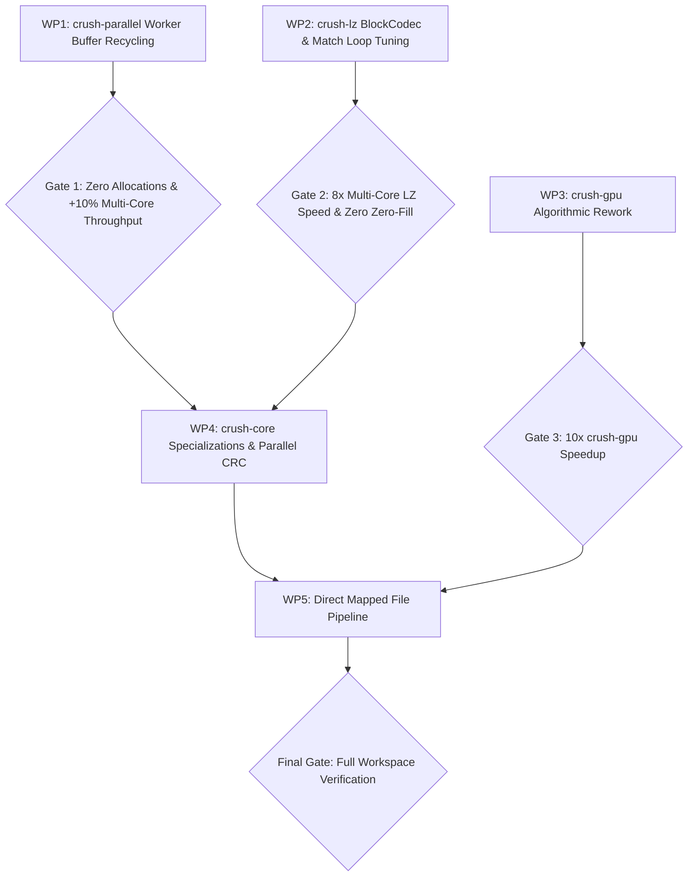

# Implementation Plan: Compression Performance Optimization

**Branch**: `027-compression-perf-plan` | **Date**: 2026-11-01 | **Spec**: [spec.md](spec.md)

**Input**: Findings and architectural opportunities from the codebase-wide compression performance audit ([research.md](research.md)).

---

## 1. Summary

Systematically eliminate memory allocation thrashing, single-threaded execution bottlenecks, and algorithmic inefficiencies across Crush's compression functions. Work is partitioned into five distinct, independently testable work packages:

1. **`crush-parallel` Zero-Allocation Buffering**: Preserve worker thread scratch buffers across blocks, eliminating repetitive 1 MB+ heap allocations and zero-filling in Rayon tasks; streamline output assembly.
2. **`crush-lz` Parallel Scaling & Hot-Loop Tuning**: Implement `BlockCodec` for `fast-lz` to unlock multi-core scaling via `crush-parallel`; eliminate redundant memory loads in the match-finding loop; eliminate output buffer zero-fill.
3. **`crush-gpu` Algorithmic Rework**: Replace `HashMap<u32, Vec<usize>>` with flat zero-allocation sliding-window arrays; parallelize 64 KB tile compression via Rayon; replace bit-by-bit I/O with 64-bit word accumulators; pre-compute fixed Huffman and symbol tables.
4. **`crush-core` Plugin Contract Specialization**: Implement `compress_into` for `ParallelDeflatePlugin` and `DeflatePlugin` to eliminate redundant intermediate buffer copying; modernize `decompress()` outer CRC32 with parallel hashing.
5. **Direct Memory-Mapped & Streamed Compression**: Enable direct writing of compressed blocks into destination files / memory-mapped outputs in `crush-cli` and `crush-parallel`.

---

## 2. Technical Context

**Language/Version**: Rust 1.99.1 (edition 2024), pinned in `rust-toolchain.toml`  
**Primary Dependencies**: Workspace dependencies only: `rayon`, `crossbeam`, `crc32fast`, `libdeflater`, `memmap2`, `thiserror`, `criterion`, `proptest`. No new external dependencies.  
**Storage**: Memory buffers, files via `memmap2` and `std::fs::File`.  
**Testing**: `cargo test --workspace`, property-based testing (`proptest`), fuzz testing (`cargo-fuzz` >= 100k iterations), criterion benchmarks, and ABBA validation (`perf/compare.py` and `.claude/skills/perf/bench.py`).  
**Target Platform**: x86-64 and aarch64 Linux and Windows (reference hardware: 12th Gen Intel Core i9-12900K, 16c/24t).  
**Performance Goals**:
- `parallel-deflate`: >= 20% throughput increase on multi-core CPU compression (target >= 1,250 MB/s on 128 MB corpus).
- `fast-lz`: Multi-core scaling achieving >= 6,000 MB/s (up from single-core cap of ~740 MB/s); single-core speedup >= 15%.
- `crush-gpu`: 10x-20x speedup on CPU tile compression.
- Zero extra allocations in worker steady state.

---

## 3. Constitution Check

*GATE: Must pass before Phase 0 research. Re-check after Phase 1 design.*

| Principle or Gate | Status | How the Plan Satisfies It |
|---|---|---|
| **I. Performance First** | **PASS** | Every work package directly targets measured bottlenecks: allocation reduction, SIMD/word-level loads, parallel scheduling, and zero-copy data flow. Verified via `bench.py ab` and ABBA runs. |
| **II. Correctness & Safety** | **PASS** | 100% memory safe Rust. `#![forbid(unsafe_code)]` preserved on all crates unless an explicit exception is documented and gated (e.g. `set_len` or mapped files per existing constitution rules). No `.unwrap()` or `.expect()` in production code. Full roundtrip proptests and fuzzing. |
| **III. Modularity** | **PASS** | Codec interfaces remain trait-based (`BlockCodec`, `CompressionAlgorithm`). Algorithms remain swappable and independently testable. |
| **IV. Test-First (TDD)** | **PASS** | Red-Green-Refactor workflow enforced. Baseline benchmarks recorded before changes; regression tests written before optimization. |
| **Dependencies** | **PASS** | Zero new dependencies added. All work packages utilize existing workspace dependencies (`rayon`, `crc32fast`, `libdeflater`). |
| **Quality Gates** | **PASS** | Zero clippy warnings with `-D warnings`, rustfmt clean, zero test regressions. |

---

## 4. Project Structure & Affected Modules

```text
crush/
├── specs/027-compression-perf-plan/
│   ├── spec.md                       # Feature specification & user stories
│   ├── plan.md                       # This implementation plan
│   └── research.md                   # Detailed audit findings & root-cause analyses
├── crush-parallel/
│   ├── src/
│   │   ├── block.rs                  # Buffer recycling: replace mem::take with scratch swap
│   │   ├── codec.rs                  # DeflateCodec bound pre-sizing; FastLzCodec implementation
│   │   ├── engine.rs                 # Allocation-free worker loop; direct-write assembly
│   │   └── lib.rs                    # ParallelDeflatePlugin: implement compress_into & compress_to
│   └── benches/
│       └── throughput.rs             # Measure allocation and scaling delta
├── crush-lz/
│   ├── src/
│   │   ├── compress.rs               # Single-load 64-bit word fetch; eliminate resize(..., 0)
│   │   ├── codec.rs                  # NEW: BlockCodec implementation for fast-lz
│   │   └── lib.rs                    # Expose BlockCodec for crush-parallel integration
│   └── benches/
│       └── codec.rs                  # Single-core and multi-core LZ benchmarks
├── crush-gpu/
│   ├── src/
│   │   ├── lz77.rs                   # Replace HashMap with flat fixed-size hash chains
│   │   ├── gdeflate.rs               # 64-bit word BitWriter; const Huffman & O(1) symbol tables
│   │   └── engine.rs                 # Rayon tile parallelization
│   └── benches/
│       └── throughput.rs             # Benchmark tile compression improvements
├── crush-core/
│   ├── src/
│   │   ├── compression.rs            # Streamlined output prefix assembly
│   │   ├── decompression.rs          # Parallel CRC32 calculation in read_crc32_block
│   │   └── plugin/
│   │       └── default.rs            # DeflatePlugin: implement compress_into; evaluate libdeflater
└── crush-cli/
    └── src/
        └── commands/
            └── compress.rs           # Memory-mapped file output pipeline
```

---

## 5. Work Package Breakdown

### Work Package 1: `crush-parallel` Zero-Allocation Worker Buffering (P1)
- **Task 1.1**: Refactor `compress_block` in `crush-parallel/src/block.rs` to avoid `std::mem::take(scratch)`.
  - Maintain a reusable output buffer per worker. Either copy the compressed slice to the destination `BlockOutput` while preserving the vector's allocated capacity, or use a 2-buffer swap pattern (`std::mem::swap`).
- **Task 1.2**: Update `DeflateCodec::compress_block` in `crush-parallel/src/codec.rs`:
  - Check `out.capacity() < bound` instead of `out.len() < bound`.
  - Ensure capacity is reserved once and retained across all block iterations.
- **Task 1.3**: Optimize incompressible probing in `codec.rs`:
  - Fast-path probe with early exit on small 1 KB - 2 KB samples before triggering full 4 KB window collision entropy scans.
- **Task 1.4**: In `ParallelDeflatePlugin` (`crush-parallel/src/lib.rs`):
  - Implement `compress_into(&self, input: &[u8], cancel: Arc<AtomicBool>, out: &mut Vec<u8>)`.

### Work Package 2: `crush-lz` Parallel Scaling & Hot-Loop Tuning (P1)
- **Task 2.1**: Implement `BlockCodec` for `FastLz`:
  - Create `FastLzCodec` in `crush-lz` implementing `crush_parallel::codec::BlockCodec`.
  - Allow `crush-parallel` to compress and decompress `fast-lz` frames across all CPU cores.
- **Task 2.2**: Eliminate zero-fill in `crush-lz/src/compress.rs`:
  - In `push_block`, replace `out.resize(payload_at + chunk.len() + WILD, 0)` with uninitialized reservation / scratch write, eliminating memory zeroing.
- **Task 2.3**: Eliminate redundant memory loads in `find_sequences`:
  - Replace separate `read_u32` and `read_u64` calls with a single `let w = read_u64(src, i); let word = w as u32; let h = hash6(w);`.
- **Task 2.4**: Remove repetitive slice bounds checks in `read_u64` for `i < limit`.
- **Task 2.5**: Accelerate literal copies in `put_literals` using 16-byte/32-byte SIMD chunk transfers.

### Work Package 3: `crush-gpu` Algorithmic & Threading Rework (P2)
- **Task 3.1**: Re-architect `crush-gpu/src/lz77.rs`:
  - Replace `HashMap<u32, Vec<usize>>` with flat array hash tables `[u32; 65536]` and cyclic chain `[u16; 32768]`.
  - Replace scalar `count_match` with 64-bit XOR word matching.
- **Task 3.2**: Parallelize tile compression in `crush-gpu/src/engine.rs`:
  - Switch serial `tiles.iter().enumerate()` to Rayon parallel iteration `tiles.par_iter().enumerate()`.
- **Task 3.3**: Re-engineer `BitWriter` and `BitReader` in `crush-gpu/src/gdeflate.rs`:
  - Replace 1-bit-at-a-time loop with a 64-bit word accumulator.
- **Task 3.4**: Pre-compute fixed Huffman code tables as `const` arrays.
- **Task 3.5**: Replace linear searches in `encode_length` and `encode_distance` with direct table lookups.

### Work Package 4: `crush-core` Plugin Contract Specialization & Decompression CRC (P2)
- **Task 4.1**: Implement `compress_into` in `crush-core/src/plugin/default.rs` (`DeflatePlugin`).
- **Task 4.2**: Replace serial CRC in `crush-core/src/decompression.rs` (`read_crc32_block`) with `parallel_crc32` for payloads >= 8 MB.

### Work Package 5: Direct Memory-Mapped File Compression (P3)
- **Task 5.1**: Add `compress_to_file` in `crush-parallel` supporting pre-allocated memory-mapped file output, matching the parallel decompress pattern from Feature 026.
- **Task 5.2**: Update `crush-cli/src/commands/compress.rs` to route large file compression directly through the mapped file pipeline.

---

## 6. Delivery Order and Go/No-Go Gates



### Gate Criteria:
- **Gate 1**: `python .claude/skills/perf/bench.py ab --suite cpu-compress` validates >= 10% improvement with zero per-block allocations in steady state. Zero regressions in roundtrip tests.
- **Gate 2**: Multi-threaded `fast-lz` benchmarks show >= 6,000 MB/s on 16c hardware. Single-core `fast-lz` improves by >= 15%. Correctness verified via proptest.
- **Gate 3**: `crush-gpu` 10 MB compression runs in < 40 ms (down from > 400 ms).
- **Final Gate**: Full regression suite (`cargo test --workspace`), fuzzing (`cargo fuzz` 100k cycles), and duplicate code analysis (`detect-duplicates.ps1`).

---

## 7. Risk Analysis & Mitigation

| Risk | Impact | Likelihood | Mitigation Strategy |
|---|---|---|---|
| **Worker buffer reuse causes data corruption across blocks** | High | Low | Enforce strict length clearing (`buffer.clear()`) while preserving capacity (`buffer.capacity()`). Add proptest exercising variable block lengths and random payloads. |
| **`fast-lz` format divergence during `BlockCodec` refactor** | High | Low | Validate bit-for-bit compatibility against golden archives; test cross-compatibility between single-threaded frame reader and multi-threaded block decoder. |
| **`crush-gpu` flat hash table changes compression ratio** | Medium | Medium | Benchmark compression ratio on standard corpora (log, binary, mixed) before and after. Standard 3-byte hash with 32 KB window preserves or improves match quality. |
| **Performance regression on small inputs (<64 KB)** | Medium | Low | Maintain small-input fast paths that bypass thread pool setup and multi-block index overhead. |
